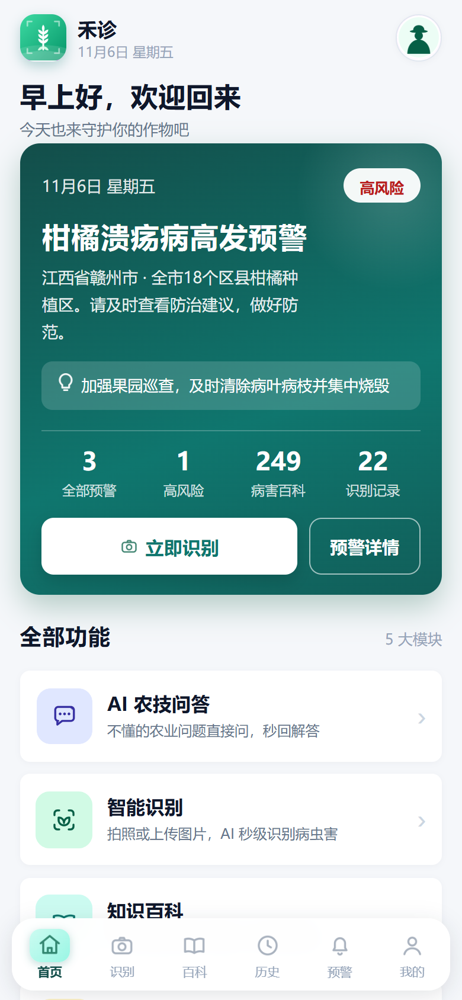
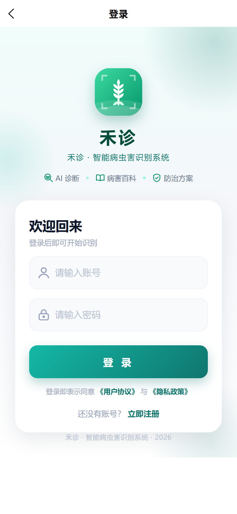
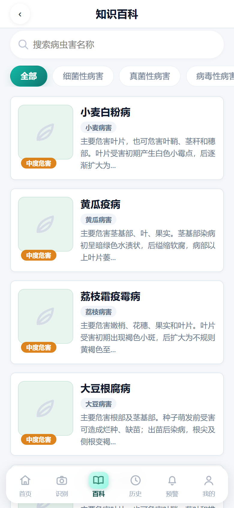
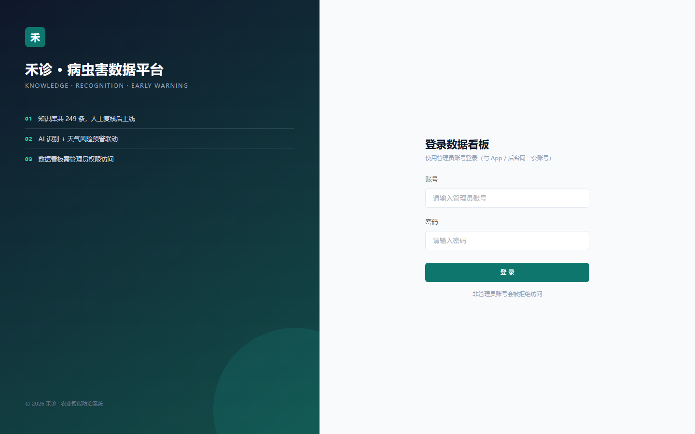
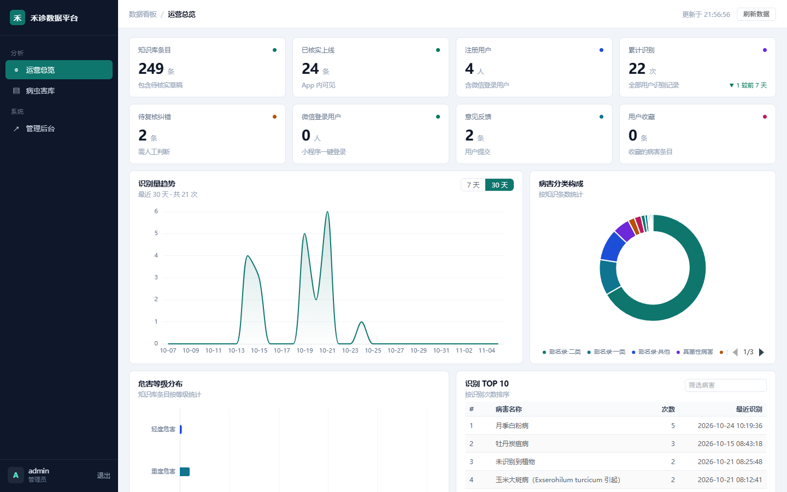
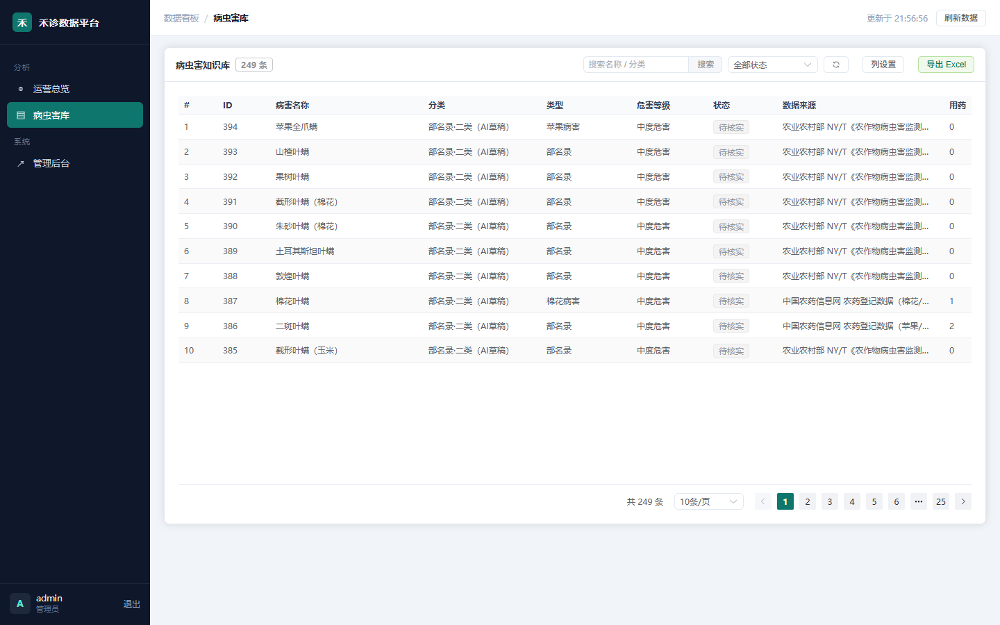
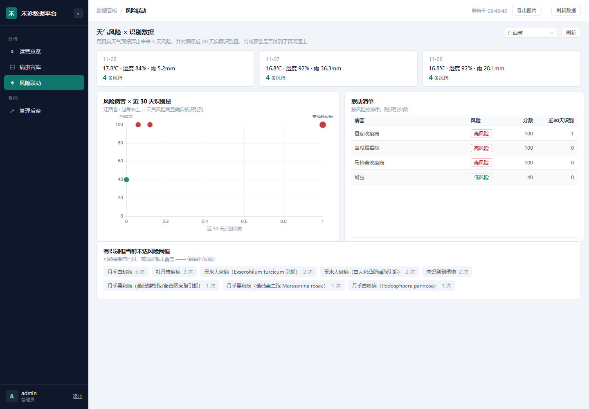

# 禾诊 · 智能病虫害识别系统 — 开发文档

> 版本：v1.0　｜　更新日期：2026-10-25
> 项目路径：`C:\Users\24886\Documents\HBuilderProjects\禾诊`

---

## 一、项目简介

禾诊是一个面向农户的作物病虫害识别与防治指导系统。用户拍照或实时对准作物，系统识别病虫害并给出**有官方登记依据的用药方案**，同时提供知识百科、预警、识别历史、收藏与 AI 农技问答。

**三种运行形态**（同一套代码）：

| 形态 | 说明 | 入口 |
|---|---|---|
| H5 网页 | 浏览器直接访问，开发调试主形态 | `http://localhost:5173` |
| 微信小程序 | 已配置 AppID，可发布 | 微信开发者工具 |
| Android App | 通过 HBuilderX 云打包生成 APK | `发行 → 云打包` |

**核心特色**：不是"调个大模型就完事"，而是把 **AI 识别 + 官方农药登记库 + 农业农村部病虫害名录 + 人工核实** 串成一条可追溯的数据链。

---

## 二、技术栈

### 2.1 前端

| 技术 | 版本/说明 | 用途 |
|---|---|---|
| uni-app（Vue 3） | Vue 3 + Vite | 一套代码编译 H5 / 小程序 / App |
| 原生 CSS（rpx 单位） | 750rpx 设计基准 | 全端自适应布局 |
| 飞书式条件编译 | `#ifdef H5 / APP-PLUS / MP-WEIXIN` | 分端逻辑（如实时监测仅 H5） |
| Canvas / MediaDevices | 浏览器原生 | 实时监测抓帧 |
| 自定义图标系统 | 96 网格 SVG → PNG | 38 个图标，避免 emoji |

### 2.2 后端

| 技术 | 版本 | 用途 |
|---|---|---|
| Node.js | 24.x | 运行时 |
| Express | 4.22 | Web 框架 |
| EJS | 5.x | 后台管理页面模板 |
| **sqlite3 / sql.js** | 6.x / 1.10 | 默认数据库驱动（WAL 模式） |
| **mysql2** | 3.24 | 可选 MySQL 驱动 |
| jsonwebtoken | 9.x | 用户 JWT 鉴权（7 天有效） |
| express-session | 1.19 | 后台管理员会话 |
| bcryptjs | 2.4 | 密码哈希（cost=10） |
| multer | 2.1 | 图片上传（限 5MB） |
| express-validator | 7.3 | 表单校验 |
| dotenv | 17.x | 配置管理 |
| csurf | 1.11 | 后台 CSRF 防护 |

### 2.3 AI 与外部服务

| 服务 | 模型/接口 | 用途 |
|---|---|---|
| DeepSeek | `deepseek-flash`（OpenAI 兼容） | 识图诊断、快速识别、问答、资料补全 |
| 百度 AI | 植物识别 API | 植物物种识别（作为诊断提示） |
| 中国农药信息网 | icama.cn 农药登记查询 | 真实农药登记数据（药名/剂量/毒性/登记证号） |
| 农业农村部 | NY/T 名录（2024） | 官方病虫害名称与分类 |

### 2.4 开发工具

| 工具 | 用途 |
|---|---|
| HBuilderX 5.06 | uni-app 编译、运行、云打包 |
| HBuilderX 内置 Amazon Corretto | keytool 生成签名证书 |
| Git | 版本管理 |

---

## 三、系统架构

```
┌────────────────────── 客户端（uni-app 一套代码三端）──────────────────────┐
│  首页  识别  实时监测  百科  历史  预警  我的  登录/注册  设置  帮助  反馈  AI问答  │
└──────────────────────────────────┬──────────────────────────────────────────┘
                                   │ HTTP/JSON（JWT）
┌──────────────────────────────────▼──────────────────────────────────────────┐
│                      Express 后端（:3000）                                    │
│  routes/   user · disease · history · collection · warning · chat · admin     │
│  middleware/  auth（JWT）· loginGuard（锁定）· rateLimit · production         │
│  config/db.js  →  驱动开关  →  sqlite3  或  mysql2                            │
│                                                                              │
│  识别流水线：                                                                  │
│   上传图片 → 百度植物识别 → DeepSeek 识图/快速识别 → 匹配本地知识库             │
│            → 补全官方用药 → 回填配图 → 写历史 → 返回结构化结果                  │
└──────────────┬───────────────────────────────────┬───────────────────────────┘
               │                                   │
      ┌────────▼────────┐                 ┌────────▼─────────┐
      │ 本地知识库       │                 │ 外部 AI / 登记库  │
      │ 10 张表 · 249 病害 │                 │ DeepSeek / 百度   │
      └─────────────────┘                 │ ICAMA 登记查询    │
                                          └──────────────────┘
```

---

## 四、目录结构

```
禾诊/
├── pages/                     16 个页面
│   ├── index/                 首页（预警面板 + 功能入口 + 统计）
│   ├── recognize/             拍照识别（单张 / 连拍 / 实时监测入口）
│   ├── realtime/              实时监测（H5 专属，天网式 HUD）
│   ├── encyclopedia/          知识百科（搜索 + 分类筛选）
│   ├── encyclopedia-detail/   病虫害详情（症状/病因/用药/来源）
│   ├── history/               识别历史
│   ├── agreement/             用户协议
│   ├── privacy/               隐私政策
│   ├── warning/               病虫害预警
│   ├── profile/               我的（统计 + 菜单）
│   ├── collection/            我的收藏
│   ├── chat/                  AI 农技问答
│   ├── login/ register/       登录注册
│   ├── settings/ help/ feedback/ profile-edit/
├── components/
│   ├── NavBar.vue             顶部导航（自定义导航栏）
│   └── TabBar.vue             底部悬浮胶囊导航
├── utils/
│   ├── api.js                 所有后端请求封装
│   ├── config.js              后端地址自动探测（H5 用当前域名 / App 用固定 IP）
│   ├── guest.js               游客额度（识别 3 次 / 问答 3 次）
│   ├── helpers.js             用药/列表格式化
│   ├── nav.js / wininfo.js    导航与状态栏适配
├── static/
│   ├── icons/                 38 个功能图标（PNG + SVG 源）
│   ├── appicon/               7 种尺寸 App 图标
│   └── logo.png 等
├── styles/auth.css            登录/注册共用样式
├── manifest.json              应用配置（多端 + 图标 + 权限 + 模块）
├── pages.json                 路由与窗口配置（含 H5 条件编译）
└── agriculture-backend/
    ├── app.js                 入口（中间件、路由挂载、启动）
    ├── config/
    │   ├── db.js              SQLite 实现 + **驱动开关**
    │   └── db-mysql.js        MySQL 适配层（同名 dbRun/dbGet/dbAll）
    ├── routes/                7 个路由文件（57 个端点）
    ├── controllers/           5 个控制器
    ├── middleware/            auth / loginGuard / rateLimit / production
    ├── views/admin/           12 个 EJS 后台页面
    ├── public/uploads/        上传与病害图片
    ├── scripts/               数据采集与运维脚本 8 个
    └── agriculture.db         SQLite 数据库（默认驱动）
```

---

## 五、功能清单

### 5.1 面向用户

| 模块 | 功能 |
|---|---|
| **智能识别** | 拍照/相册选图；**单张**与**连拍（最多 3 张）**两种模式；AI 返回病名、置信度、危害等级、症状、防治方案；自动匹配本地知识库并补全真实用药 |
| **实时监测**（H5） | 摄像头实时预览 + 扫描线 HUD；每 2.5 秒抓帧、画面变化才识别；结果叠加在画面上；带最近识别记录；点「查看完整详情」跳百科 |
| **知识百科** | 249 条病虫害（19 条人工核实 + 222 条官方名录待核实）；关键字搜索、分类筛选、病害详情（症状/病因/传播/发生规律/用药/防治/预防）|
| **识别历史** | 自动保存（登录用户）；分页列表、详情、单条删除、一键清空 |
| **收藏** | 百科详情页收藏、收藏列表管理 |
| **预警** | 病虫害预警列表（地区/等级/防治建议/时间）+ **本地风险预测**（按真实天气自动算未来 3 天）|
| **分享** | 百科详情页分享：小程序转发卡片、H5 复制链接、App 复制下载地址 |
| **更新检查** | App 内「设置 → 检查更新」，比对后端 versionCode 提示下载（微信/网页随服务器更新）|
| **AI 农技问答** | 多轮对话；游客 3 次免费，登录不限 |
| **账号** | 注册、登录、修改资料（昵称/头像）、修改密码、退出 |
| **其他** | 设置、使用帮助、意见反馈、游客模式（识别 3 次）|

### 5.2 知识库与数据治理

| 能力 | 说明 |
|---|---|
| **双驱动数据库** | SQLite（默认）/ MySQL，改 `.env` 一行切换 |
| **数据核实闸门** | `verified` 字段控制：未核实数据**不会出现在 App**（列表/详情/识别匹配全部过滤）|
| **数据来源追溯** | 每条带 `verify_source`（出处）+ `verify_date`（核对日期），App 详情页可见 |
| **AI 草稿标记** | 自动生成的内容分类里带「（AI草稿）」，核实时自动去除 |
| **自动回填配图** | 识别命中且置信度 ≥70 时，自动把照片补为该病害配图 |
| **纠错学习** | 用户纠错写入 `corrections`，并可用于修正历史、补录知识库 |
| **AI 自动收录** | 识别到库中没有的病害 → 收录为待核实条目（不直接上线）|

### 5.3 后台管理（17 个页面/端点组）

数据概览 · 用户管理 · 病虫害库（增删改查/补图/核实/隐藏）· 识别历史 · 用户纠错 · 意见反馈 · 安全与登录日志 · 修改密码

---

## 六、核心流程

### 6.1 识别流程（`POST /api/disease/recognize`）

```
1. multer 接收图片（≤5MB，仅图片类型；支持无扩展名的 blob）
2. 百度植物识别（可选）→ 得到植物名 + 简介，作为提示
3. DeepSeek 识图（multimodal）→ 返回 JSON：
   { plantName, diseaseName, confidence, level, symptom, cause, spread,
     occurrence, medicines, suggestions, prevention, evidence, differentials }
4. 判断是否"未识别到植物" → 如实返回，不编造
5. 用病害名匹配本地库（0.72 相似度阈值 + 病/虫类型区分）
   ├─ 命中 → 本地字段优先；缺失字段用 AI 补；比较择优回写
   └─ 未命中 → autoLearnDisease 收录（verified=0，带图）
6. 补全官方用药（本地库 + ICAMA 登记数据）
7. 登录用户写识别历史（saveHistory）
8. 返回结构化结果（含 dataSource、matched、levelText 等）
```

**快速通道**（实时监测用）：`?fast=1` → 跳过百度，短提示词 `max_tokens=120`，只返回病名/置信度/等级，实测 **0.8 秒**。
> ponytail: 快速通道不写历史、不学习，避免每 2.5 秒污染知识库；需要学习走完整流程。

### 6.2 实时监测（H5 专属页面）

```
getUserMedia(1280×720) → <video> 覆盖全屏
  ├─ 每 2.5 秒：canvas 抓帧 → JPEG(0.92) → blob URL → 上传 fast=1
  ├─ 画面变化检测：16×12 灰度签名，差异 >4 才识别；静止画面 6 秒兜底刷新
  ├─ 被限流(429) → 自动退避 8 秒，不弹错
  ├─ 结果卡片：病名 / 置信度 / 危害等级 / 寄主 / 类别 / 症状 / 用药(含毒性) / 防治
  └─ 「查看完整详情」→ 先 stop() 释放摄像头 → 跳百科详情
诊断：状态芯片（待机/识别中/已识别/未就绪）+ 版本行 + 错误提示常驻卡片
```

### 6.3 知识库审核流程

```
数据来源              进入方式                        状态
─────────────────────────────────────────────────────────────
人工维护 19 条    →  种子数据                     → verified=1（直接上线）
农业农村部名录     →  scripts/import-moa-list.js   → verified=0（待核实）
AI 生成草稿        →  scripts/fill-drafts.js        → verified=0 + 「AI草稿」标记
官方农药登记       →  scripts/fetch-registry.js     → 只更新用药，不改 verified
CSV 人工导入       →  scripts/import-verified.js    → verified=1（必须填数据来源）
后台核实           →  后台「核实」按钮              → verified=1（自动去掉草稿标记）
后台批量核实       →  勾选多条 → 批量核实           → verified=1；没来源的跳过并报数
```

**核实前必须填写数据来源**（`verify_source`），否则后台拒绝上线。

**批量核实**：后台「病虫害库 → 待核实」页勾选多条 → 点「批量核实选中的」，
接口 `POST /admin/diseases/batch-verify` 逐条检查，没填来源的自动跳过并报数。

> 来源只证明「名录里有这个病」，症状和用药是 AI 生成的 —— 批量核实省的是点按次数，不是审核工作。

### 6.3.1 后台审核台（逐条过内容）

后台 → **审核台**：一次显示一条完整内容，判断通过 / 待改 / 跳过。

```
GET  /admin/review            取一条待审记录（优先有来源的）
POST /admin/review/:id/decision   action=approve|revise|skip
     approve → verified=1 + 补核对日期 + 去掉「（AI草稿）」
     revise  → review_state='revise'，记 note，留在待核实
     skip    → review_state='skip'，本轮不再出现
```

页面顶部显示三个数字：待审核 / 标记待改 / 已上线，处理完自动跳下一条。

**为什么单独做一页**：

| 方式 | 适合 |
|---|---|
| 审核台（逐条） | 认真过内容，看完整字段，写备注 |
| 病虫害库 → 批量核实 | 已经确认过质量，成批上线 |
| 抽样清单脚本 | 批量核实前摸底，心里有数 |

三者互补，不是替代关系。

---

### 6.4 用户纠错 · 人工复核闭环

用户觉得 AI 判错了，在识别结果页提交「正确答案」→ 这条纠正不是直接上线，而是进入**待复核队列**。

```
用户在 App 提交纠错
        │
        ▼
POST /api/disease/correct
        ├─ 写入 corrections（status = pending）
        ├─ 修正对应识别历史（corrected = 1）
        └─ 知识库没有这个病 → 自动收录一条 verified = 0 的草稿
                            （有 AI 密钥时顺带生成完整防治方案）
        │
        ▼
后台「用户纠错 → 待复核」
        ├─ 通过 → 对应病害 verified = 1
        │        verify_source = 「用户纠错 · 人工复核」
        │        verify_date   = 当天
        └─ 驳回 → status = rejected（记原因，不采信，病害保持草稿）
        │
        ▼
App 详情页显示「✓ 已核实」徽章 + 资料来源与核对日期
```

**关键设计**

| 点 | 说明 |
|---|---|
| 双状态 | 纠正本身有 `pending/approved/rejected`；病害有 `verified`。两者分开，避免"改错一条就上线" |
| 幂等 | 同一病害被反复纠正不会重复建记录（`matchLocalDisease` 查全库，包含草稿）|
| 可追溯 | 谁复核的（`reviewer`）、什么时候（`reviewed_at`）、为什么驳回（`note`）都落库 |
| 用户可见 | 只有 `verified = 1` 的病害才出现在百科和详情接口里 |

接口：

```
POST /admin/corrections/:id/review
  body: action=approve|reject  note=备注（可选）
  通过会校验知识库里确实存在该病害，找不到就提示先去新增
```

---

### 6.5 天气风险预警（自动估算）

**问题**：原来预警页的 3 条数据是管理员手填的，换个地区就没有内容。

**做法**：用真实天气预报 + 知识库里每条病害的「发病条件」原文做条件匹配。

```
Open-Meteo（免费、免密钥）
  按省份取坐标 → 未来 3 天 温/湿/雨
        ↓
risk_rules（18 条，来源=知识库 occurrence 原文）
        ↓
lib/risk.js 打分
        ├─ 温度落在适发区间  40 分
        ├─ 湿度达到起病阈值  35 分
        └─ 降雨达到临界值    25 分
     ≥70 高风险 · ≥45 中风险 · ≥20 低风险
        ↓
GET /api/warning/risk?region=江西省
        ↓
预警页「本地风险预测」卡片（每天最多 5 条，附触发原因）
```

**为什么这样做**

| 选择 | 理由 |
|---|---|
| Open-Meteo 而不是和风 | 不用注册、不用 Key，换台电脑也能跑；和风要申请额度 |
| 规则表而不是让 AI 猜 | 可解释、可审计；每条规则存 note（原文摘录），出错能追到知识库哪句 |
| 省份省会坐标 | 预警页本来就只有省级筛选，够用；避免要定位权限 |
| 30 分钟缓存 | 外部接口有限流，缓存后翻页不重复请求 |
| 接口带 disclaimer | 这是条件匹配不是预测模型，不能让用户当成精确结论 |

**规则示例（risk_rules）**

| 病害 | 温度 | 湿度 | 降雨 | 月份 | 来源原文 |
|---|---|---|---|---|---|
| 番茄晚疫病 | 16~24℃ | ≥90% | 不限 | 4-6、9-1 月 | 低温高湿（18-22℃，相对湿度>90%）|
| 辣椒疫病 | 25~35℃ | ≥80% | ≥15mm | 全年 | >25℃、暴雨积水后 3-5 天暴发 |
| 小麦锈病 | 9~25℃ | ≥80% | 不限 | 3-5 月 | 早春 9-15℃、叶锈秆锈 15-25℃ |
| 蚜虫 | 15~28℃ | 30~70% | ≤3mm | 全年 | 春秋繁殖高峰，温暖干燥有利 |

**接口**

```
GET /api/warning/risk?region=江西省

200 →
{
  "code": 200,
  "data": {
    "region": "江西省", "city": "南昌",
    "updated": "2026-11-05T07:0x:xxZ",
    "days": [
      { "date": "2026-11-07", "tmean": 17, "humidity": 92, "rain": 45.4,
        "items": [ { "diseaseId": 3, "name": "番茄晚疫病", "score": 100,
                     "level": 3, "levelText": "高风险",
                     "reasons": ["均温 17℃（适发 16~24℃）", "湿度 92%（条件 ≥90%）", "降雨 45.4mm（条件 ≥0mm）"],
                     "source": "低温高湿（18-22℃，相对湿度>90%）" } ] } ],
    "ruleCount": 18,
    "disclaimer": "按天气预报与已知发病条件匹配估算，仅供参考；具体防治请结合田间实际。"
  }
}

400 → 不支持该地区（返回 supported 列表）
```

**前端**：预警页地区切换后自动重算；选「全国」时显示提示而不是空白。

---

### 6.6 分享与版本更新

**分享**

| 端 | 行为 |
|---|---|
| 微信小程序 | `onShareAppMessage` / `onShareTimeline` 生成卡片（标题=寄主+病名，图=病害图），走右上角「···」转发 |
| H5 | 手机浏览器用 `navigator.share`；桌面复制链接（2.5 秒超时兜底，避免点了没反应）|
| App | 复制下载地址，方便发给别人 |

分享链接格式：`#/pages/encyclopedia-detail/encyclopedia-detail?id=<病害id>`，打开后自动拉详情。

**版本更新**

```
App 启动 / 设置页点「检查更新」
        ↓
GET /api/version  →  agriculture-backend/version.json
        ↓
本地 versionCode  <  最新 versionCode ？
        ├─ 是 → 弹窗「发现新版本」→ 系统浏览器打开下载地址
        └─ 否 → 提示已是最新
```

`version.json` 内容（发版时改这一个文件）：

| 字段 | 说明 |
|---|---|
| `android.versionName` | 显示版本，如 1.0.1 |
| `android.versionCode` | 整数，必须递增，App 靠它判断新旧 |
| `android.url` | APK 下载地址（GitHub raw 直链）|
| `android.notes` | 更新说明 |

> 网页版和微信小程序不检查更新——它们跟着服务器走，刷新就是最新。

---

## 七、数据库设计

### 7.1 驱动架构

```
config/db.js
  ├─ DB_DRIVER=sqlite → 原生 sqlite3（WAL）
  └─ DB_DRIVER=mysql  → require('./db-mysql')（mysql2 连接池）

两者对外暴露完全相同的接口：
  dbRun(sql, params) → { changes, insertId, lastID }
  dbGet(sql, params) → row | null
  dbAll(sql, params) → rows[]
  initDB() / safeParseJSON() / getDB() / DB_PATH
```

**方言自动翻译**（适配层内）：

| SQLite | MySQL |
|---|---|
| `datetime('now')` / `datetime("now")` | `NOW()` |
| `datetime('now','-N days/minutes/hours')` | `DATE_SUB(NOW(), INTERVAL N UNIT)` |
| `INSERT OR IGNORE` | `INSERT IGNORE` |
| `date(col)` | `DATE(col)` |
| 会话时区 | 每个连接 `SET time_zone='+00:00'`（与 SQLite UTC 语义一致）|

### 7.2 数据表（10 张）

| 表 | 列 | 说明 |
|---|---|---|
| `users` | 8 | id, username(唯一), password(bcrypt), create_time, is_admin, nickname, avatar, pwd_changed_at |
| `diseases` | 19 | id, name(唯一), type, category, level, level_text, image, host, period, symptom, cause, spread, occurrence, medicines(JSON), suggestions(JSON), prevention(JSON), **verified**, **verify_source**, **verify_date** |
| `histories` | 19 | 识别记录：user_id, disease_name, image/image_url, confidence, level, 症状/防治快照, create_time, plant_name, ai_source, evidence, corrected |
| `collections` | 7 | 收藏：user_id, disease_id, name, type, image |
| `warnings` | 9 | 预警：title, level, level_text, location, area, suggestion, is_new |
| `corrections` | 7 | 纠错：history_id, user_id, ai_name, correct_name, plant_name |
| `login_logs` | 8 | 登录日志：username, user_id, ip, success, reason, source |
| `feedback` | 5 | 反馈：user_id, type, content |

| `risk_rules` | 11 | 风险规则：disease_id, disease_name, temp_min/max, humidity_min/max, rain_min/max, months, note, enabled |
| `schema_version` | 4 | 迁移记录：id, name, driver, applied_at |

**当前数据量**：diseases 249 · histories 22 · users 4 · warnings 3 · corrections 4 · login_logs 108 · feedback 2 · collections 0 · risk_rules 18

### 7.3 数据迁移

**（一）整库迁移：SQLite → MySQL**

```bash
node scripts/migrate-to-mysql.js --dry-run   # 预演（只看行数）
node scripts/migrate-to-mysql.js             # 实际迁移（INSERT IGNORE，可重复跑）
```

**保留原始自增 id**（histories.user_id / corrections.history_id / collections.disease_id 依赖它）；迁移前会清空目标表，可重复执行；结束后自动重置自增起点。SQLite 原文件不删除，可随时切回。

> 历史坑：早期版本迁移时跳过 id，导致 id 整体前移、历史记录全部变成孤儿数据 —— 已修复，迁移后 8 张表 id 与 SQLite 逐条一致。

**（二）表结构版本化：migrations/**

改表结构不再往 `initTables()` 里塞 ALTER，而是新增一个迁移文件，启动时自动执行：

```bash
cd agriculture-backend
npm run migrate        # 查看哪些还没执行
npm run migrate:up     # 手动执行（平时启动会自动跑）
```

| 迁移 | 内容 |
|---|---|
| `001_indexes.js` | 补 histories/collections/diseases/warnings 的查询索引 |
| `002_corrections_review.js` | corrections 表加 status / reviewer / reviewed_at / note / disease_id |
| `003_risk_rules.js` | 新建 risk_rules 表，并按知识库"发病条件"原文写入 18 条规则 |
| `004_risk_season_fix.js` | 修正季节窗口（小麦锈病只在 3-5 月等）|

执行记录写在 `schema_version` 表（id、name、driver、applied_at），换数据库、换电脑都能复现结构。
迁移文件格式与可用工具见 `agriculture-backend/migrations/README.md`。

> 注意：MySQL 的 TEXT 列不允许 DEFAULT，枚举型字段用 VARCHAR(16)。

---

### 7.4 查看与维护数据库

#### 当前数据（2026-10-25 实测）

| 表 | 行数 | 列数 | 用途 |
|---|---|---|---|
| `diseases` | 249 | 19 | 病虫害知识库 |
| `histories` | 22 | 19 | 识别历史 |
| `users` | 4 | 8 | 用户 |
| `login_logs` | 108 | 8 | 登录日志 |
| `corrections` | 4 | 7 | 用户纠错 |
| `warnings` | 3 | 9 | 预警 |
| `feedback` | 2 | 5 | 意见反馈 |
| `collections` | 0 | 7 | 收藏 |

#### 方式一：MySQL Workbench（图形化）

安装包自带（本机已装 8.0 CE）。新建连接：

| 字段 | 值 |
|---|---|
| Connection Name | 禾诊-本地 |
| Hostname | 127.0.0.1 |
| Port | 3306 |
| Username | `hezhen` |
| Password | `<MySQL密码>`（勾选 Store in Vault）|
| Default Schema | `hezhen` |

连接后左侧展开 `hezhen → Tables`，双击表即可浏览/编辑数据，或点工具栏写 SQL。
管理员账号：`root` / `<MySQL root 密码>`（可看全部库）。

#### 方式二：命令行

```powershell
& "C:\Program Files\MySQL\MySQL Workbench 8.0\mysql.exe" -h 127.0.0.1 -u hezhen -p<MySQL密码> hezhen
```

开始菜单里也有现成入口：**MySQL 8.0 Command Line Client - Unicode**。

```sql
SHOW TABLES;
SELECT id, name, category, verified FROM diseases LIMIT 10;
```

#### 方式三：SQLite（不切 MySQL 时）

```sql
-- 任意 SQLite 工具打开 agriculture-backend/agriculture.db
SELECT id, name FROM diseases WHERE verified = 1;
```

#### 常用查询

```sql
-- 已核实 / 待核实数量
SELECT verified, COUNT(*) FROM diseases GROUP BY verified;

-- 按分类统计
SELECT category, COUNT(*) c FROM diseases GROUP BY category ORDER BY c DESC;

-- 待核实的前 20 条
SELECT id, name, host, category FROM diseases WHERE verified = 0 ORDER BY id LIMIT 20;

-- 有配图的病害
SELECT id, name, image FROM diseases WHERE image IS NOT NULL AND image <> '';

-- 最近识别记录（带用户名）
SELECT h.id, h.disease_name, u.username, h.create_time
FROM histories h LEFT JOIN users u ON h.user_id = u.id
ORDER BY h.id DESC LIMIT 10;

-- 登录失败记录
SELECT username, ip, reason, create_time
FROM login_logs WHERE success = 0 ORDER BY id DESC LIMIT 10;
```

#### ⚠️ 不要直接改这三个字段

| 字段 | 风险 |
|---|---|
| `verified` | 直接改 1 会让**没核实的数据上线**，违背数据真实性原则 |
| `verify_source` | 空值 + verified=1 会变成"无来源的上线数据" |
| `medicines` / `suggestions` / `prevention` | 是 JSON 数组，手改格式错误会让详情页解析失败 |

改数据请走后台：`http://localhost:3000/admin/diseases` —— 有格式校验、自动去草稿标记、核实必须填来源。

## 八、接口文档

共 **57 个端点**。统一响应格式：

```json
{ "code": 200, "message": "提示文本", "data": {} }
```

鉴权：用户端 `Authorization: Bearer <JWT>`；后台用 session cookie。

### 用户与认证（user.js）

| # | 方法 | 路径 | 权限 |
|---|---|---|---|
| 1 | POST | `/api/user/register` | 公开 |
| 2 | POST | `/api/user/login` | 公开 |
| 3 | GET | `/api/user/info` | 登录 |
| 4 | POST | `/api/user/logout` | 登录 |
| 5 | POST | `/api/user/feedback` | 登录 |
| 6 | POST | `/api/user/profile` | 登录 |
| 7 | POST | `/api/user/change-password` | 登录 |

### 病害识别与知识库（disease.js）

| # | 方法 | 路径 | 权限 |
|---|---|---|---|
| 8 | GET | `/api/disease/diseases/list` | 公开 |
| 9 | GET | `/api/disease/detail` | 公开 |
| 10 | POST | `/api/disease/recognize` | 公开 |
| 11 | POST | `/api/disease/recognize-batch` | 公开 |
| 12 | POST | `/api/disease/upload` | 公开 |
| 13 | POST | `/api/disease/correct` | 公开 |
| 14 | GET | `/api/disease/` | 公开 |
| 15 | GET | `/api/disease/new` | 公开 |
| 16 | GET | `/api/disease/edit/:id` | 公开 |
| 17 | GET | `/api/disease/ai-fill` | 公开 |
| 18 | POST | `/api/disease/add` | 公开 |
| 19 | POST | `/api/disease/edit` | 公开 |
| 20 | POST | `/api/disease/:id/delete` | 公开 |
| 21 | GET | `/api/disease/enrich` | 公开 |
| 22 | POST | `/api/disease/enrich/run` | 公开 |
| 23 | POST | `/api/disease/enrich` | 公开 |

### 识别历史（history.js）

| # | 方法 | 路径 | 权限 |
|---|---|---|---|
| 24 | POST | `/api/history/add` | 登录 |
| 25 | GET | `/api/history/list` | 登录 |
| 26 | GET | `/api/history/detail` | 登录 |
| 27 | POST | `/api/history/delete` | 登录 |
| 28 | POST | `/api/history/clear` | 登录 |

### 收藏（collection.js）

| # | 方法 | 路径 | 权限 |
|---|---|---|---|
| 29 | POST | `/api/collection/add` | 登录 |
| 30 | GET | `/api/collection/list` | 登录 |
| 31 | POST | `/api/collection/delete` | 登录 |

### 预警（warning.js）

| # | 方法 | 路径 | 权限 |
|---|---|---|---|
| 32 | GET | `/api/warning/list` | 公开 |
| 32a | GET | `/api/warning/risk?region=江西省` | 公开 · 按真实天气算未来 3 天病害风险 |
| 32b | GET | `/api/version` | 公开 · App 检查更新（返回版本号 / 下载地址 / 更新说明）|
| 32c | POST | `/api/user/wx-login` | 公开 · 小程序微信一键登录（code 换 openid）|

### AI 问答（chat.js）

| # | 方法 | 路径 | 权限 |
|---|---|---|---|
| 33 | POST | `/api/chat/ask` | 公开 |

### 后台管理与页面（admin.js）

| # | 方法 | 路径 | 权限 |
|---|---|---|---|
| 34 | GET | `/admin/login` | 公开 |
| 35 | POST | `/admin/login` | 公开 |
| 36 | GET | `/admin/password` | 管理员 |
| 37 | POST | `/admin/password` | 管理员 |
| 38 | GET | `/admin/security` | 管理员 |
| 39 | GET | `/admin/logout` | 公开 |
| 40 | POST | `/admin/register` | 管理员 |
| 41 | GET | `/admin/` | 管理员 |
| 42 | GET | `/admin/users` | 管理员 |
| 43 | GET | `/admin/users/:id` | 管理员 |
| 44 | POST | `/admin/users/:id/edit` | 管理员 |
| 45 | POST | `/admin/users/:id/password` | 管理员 |
| 46 | POST | `/admin/users/:id/delete` | 管理员 |
| 47 | POST | `/admin/users/:id/clear-history` | 管理员 |
| 48 | GET | `/admin/histories` | 管理员 |
| 49 | POST | `/admin/histories/:id/delete` | 管理员 |
| 50 | POST | `/admin/histories/batch-delete` | 管理员 |
| 51 | GET | `/admin/histories/export.csv` | 管理员 |
| 52 | GET | `/admin/corrections` | 管理员 |
| 53 | POST | `/admin/corrections/:id/delete` | 管理员 |
| 53b | GET | `/admin/review` | 管理员 · 逐条审核台 |
| 53c | POST | `/admin/review/:id/decision` | 管理员 · approve / revise / skip |
| 53d | GET | `/admin/export.xlsx?type=histories\|users\|diseases\|corrections\|feedback` | 管理员 · 一键导出 Excel |
| 54 | GET | `/admin/feedback` | 管理员 |
| 55 | POST | `/admin/feedback/:id/delete` | 管理员 |
| 56 | POST | `/admin/diseases/:id/verify` | 管理员 |
| 57 | POST | `/admin/diseases/:id/image` | 管理员 |

---

## 九、认证、权限与配额

| 机制 | 规则 |
|---|---|
| 用户鉴权 | JWT（HS256，7 天有效），载荷 `{ id, username }` |
| 密码存储 | bcrypt（cost 10）；兼容早期明文（相等才过）|
| 后台鉴权 | express-session + `checkAuth`；CSRF 防护 |
| 游客额度 | 识别 3 次 / 问答 3 次（本地存储计数）|
| 登录锁定 | 15 分钟内失败 5 次 → 按账号/IP 锁定 |
| 限流 | 识别 60 次/分（实时监测需要）；登录 12 次/分；纠错 5 次/分；上传 10 次/分 |
| 上传校验 | MIME 必须 image/*；有扩展名时校验白名单；文件大小 ≤5MB |
| 越权防护 | 历史/收藏/详情均带 `user_id` 条件，只能操作自己的数据 |

---

## 十、数据来源与真实性

| 数据 | 来源 | 可信度 | 上线状态 |
|---|---|---|---|
| 名称 / 一类二类分类 | 农业农村部 NY/T 名录（293 条，带编码）| ✅ 官方 | 待人工核实 |
| 用药 / 剂量 / 毒性 / 登记证号 | 中国农药信息网（icama.cn）实时查询 | ✅ 官方登记 | 随条目核实 |
| 症状 / 病因 / 发生规律 | AI 生成草稿 | ⚠️ 需核对 | 待人工核实 |
| 人工维护的 19 条 | 教材 + 人工整理 | ✅ 已核实 | 已上线 |

**真实性保障三原则**：

1. **没来源不上线**：`verify_source` 为空时，后台「核实」按钮直接拒绝。
2. **AI 内容有标记**：分类带「（AI草稿）」，避免与人工数据混淆；核实时自动清除。
3. **可追溯**：App 详情页展示「资料来源：xxx（核对日期）」，用户与评审都能查证。

**已知的数据边界**：名录中 8 条（月季白粉病、牡丹炭疽病等）在中国农药登记库中**无登记药剂**，这是真实结论，不编造用药。

---

### 忘记管理员密码怎么办

```bash
cd agriculture-backend
node scripts/reset-admin-password.cjs            # 生成随机强密码并打印
node scripts/reset-admin-password.cjs --pwd 'Abc12345!'   # 指定密码
node scripts/reset-admin-password.cjs --user yin          # 改其他账号
```

改完：App / 小程序 / 管理后台都用新密码；记得同步 `.env` 里的 `E2E_ADMIN_PASSWORD`（回归测试要用）。

## 十一、部署与打包

### 11.1 后端启动
#### 一键启动脚本（Windows）

项目根目录内置 6 个脚本，双击即用：

| 文件 | 作用 |
|---|---|
| `一键启动.bat` → `start-all.ps1` | 后端 + 前端一起启动，自动打开页面 |
| `启动后端.bat` → `start-backend.ps1` | 只启动后端，打开管理后台 |
| `停止服务.bat` → `stop-all.ps1` | 停止后端（`-IncludeH5` 连前端一起停）|

脚本会自动完成这些检查：

1. 读 `.env` 判断用 SQLite 还是 MySQL
2. MySQL 驱动时检查 `MySQL80` 服务，没启动就拉起来
3. 检查 3000 端口是否被占用（已运行则直接打开页面，不重复启动）
4. 检查 node 是否存在
5. 启动后轮询 `/api/health`，最长等 20 秒，成功才提示


```bash
cd agriculture-backend
npm install
# .env 配置：PORT / DEEPSEEK_API_KEY / BAIDU_API_KEY / BAIDU_SECRET_KEY
#             DB_DRIVER=sqlite|mysql，MySQL 还需 MYSQL_HOST/PORT/USER/PASSWORD/DATABASE
node app.js
# 或生产模式
pm2 start ecosystem.config.js --env production
```

启动后：`http://localhost:3000`（接口）、`/admin`（后台，默认 admin / <管理员密码>）

### 11.2 MySQL 初始化

```sql
-- scripts/mysql-init.sql
CREATE DATABASE IF NOT EXISTS hezhen DEFAULT CHARACTER SET utf8mb4 COLLATE utf8mb4_0900_ai_ci;
CREATE USER IF NOT EXISTS 'hezhen'@'localhost' IDENTIFIED BY '<MySQL密码>';
GRANT ALL PRIVILEGES ON hezhen.* TO 'hezhen'@'localhost';
FLUSH PRIVILEGES;
```

然后：迁移数据 → `.env` 改 `DB_DRIVER=mysql` → 重启。

### 11.3 H5

```bash
HBuilderX → 运行 → 运行到浏览器（:5173）
# 或本地构建
cli publish web --project <项目路径>    # 输出 unpackage/dist/build/web
```

### 11.4 微信小程序

```bash
cli launch mp-weixin --project <项目路径> --compile true
```
AppID：`wxad5fc24db487f28b`；注意小程序要求后端 **HTTPS**。

### 11.5 Android App（APK）

```bash
# 前置：manifest.json 填 appid（__UNI__F1A0C88）+ 勾选 Camera 模块（已配）
HBuilderX → 发行 → 原生App-云打包
  证书：keystore/hezhen.keystore（别名 hezhen，密码 <MySQL密码>）
```

**App 与后端的地址**：`utils/config.js` 的 `BACKEND_HOST`（只影响 App/小程序，H5 走 `window.location`）。

⚠️ Android 9+ 默认禁止明文 HTTP。若 App 连不上后端，需升级 HTTPS（cloudflared 隧道 / 域名+证书）或本地打包加 `usesCleartextTraffic`。

### 11.6 真实上线检查清单

| 项 | 状态 |
|---|---|
| HTTPS | ❌ 未配（上线必须）|
| 数据库备份 | ❌ 未配（建议每日 `.backup`）|
| JWT 密钥外置 | ❌ 仍硬编码在 4 个文件 |
| session 密钥 | ⚠️ 有默认值回退 |
| helmet 安全头 / trust proxy | ❌ 未启用 |
| PM2 守护 | ✅ 已配置 |
| 限流 | ✅ 已配 |
| 上传目录清理 | ❌ 无（只会增长）|

---

## 十二、运维脚本

### 推送代码（国内网络）

GitHub 的 SSH(22) 和 HTTPS 直连经常被重置，开了本地代理后用：

```powershell
powershell -ExecutionPolicy Bypass -File scripts\push.ps1
```

脚本先试 SSH，失败自动走 HTTPS + 代理（默认 127.0.0.1:7890），成功后同步 origin/main 引用。

| 脚本 | 作用 |
|---|---|
| `import-moa-list.js` | 导入农业农村部 293 条名录（过滤鼠害）|
| `fetch-registry.js` | 从 ICAMA 抓真实农药登记（支持 `--only` / `--missing` / `--refresh` / `--dry-run`）|
| `fill-drafts.js` | 给待核实条目生成 AI 症状草稿（打「AI草稿」标记）|
| `batch-import.js` | 按名称清单批量建库（AI 生成资料，入库待核实）|
| `import-verified.js` | CSV 导入（**必须填数据来源**，直接 verified=1）|
| `migrate-to-mysql.js` | SQLite → MySQL 数据迁移 |
| `mysql-init.sql` | 建库建账号 |
| `e2e-test.cjs` | 端到端回归测试（40 项，支持 MySQL/SQLite 双驱动，自动清理测试数据）|
| `disease-names.txt` / `data/moa-pest-list.json` | 种子清单 |

---

## 十三、测试记录

| 项 | 结果 |
|---|---|
| 识别（完整流程）| ✅ 玉米大斑病 85~92%，3~6 秒 |
| 识别（fast=1）| ✅ 0.8 秒，92% |
| 实时监测抓帧识别 | ✅ 图片源测试 3 秒一轮，结果叠加正常 |
| MySQL 数据迁移 | ✅ 390 行，8 表行数一致 |
| MySQL 回归 | ✅ 登录/注册/百科/详情/历史/统计/预警/后台 4 个页面 |
| SQLite 回退 | ✅ `DB_DRIVER=sqlite` 正常，249 条 |
| 小程序编译 | ✅ 15 页，0.87 MB |
| 端到端回归（MySQL）| ✅ 40/40 通过，26~33 秒 |
| 端到端回归（SQLite）| ✅ 40/40 通过 |
| 数据完整性 | ✅ 8 张表行数一致，7 张表 id 逐条一致 |
| H5 页面渲染 | ✅ 8 个页面无 JS 报错（Chrome 无头渲染）|
| 后台页面 | ✅ 9 个页面正常渲染 |
| H5 桌面端布局 | ✅ 750px 居中列，375px 手机端不变 |

---

## 十四、已修复问题记录（踩坑档案）

### 「检查更新」永远提示已是最新（2026-11-06）

**现象**：装 1.0.1/1.1.0 的 APK，点设置里的检查更新，永远弹「当前已是最新版本」，服务器日志里**根本没有 /api/version 请求**。

**原因**：`pages/settings/settings.vue` 的 `methods` 里有**两个** `checkUpdate`：

```js
methods: {
  async checkUpdate() { /* 真逻辑：请求 /api/version 比对版本 */ },
  checkUpdate() { uni.showToast({ title: '当前已是最新版本' }) }   // ← 假的，写在后面
}
```

对象字面量里同名键后者覆盖前者 → 真的被假的吃掉。

**排查方法**：从 APK 里抽出 `assets/apps/*/www/app-service.js`，搜方法名看编译后到底是哪段在跑；
再看后端 access log 有没有请求 —— 没请求就说明客户端根本没调接口。

**修复**：删掉假方法；版本升到 1.1.1（111），让已装的 1.1.0 也能识别到更新。

**教训**：改完页面上的按钮，要确认**编译产物**里调的到底是哪段代码，不能只看源码里有实现。

> 记录 MySQL 改造与联调过程中真实踩到、并已修复的问题。每个问题都写清**现象 → 原因 → 修复 → 验证**，避免以后重复掉坑。

### 14.1 统计与登录类 SQL 在 MySQL 下语法错误

| 项 | 内容 |
|---|---|
| **现象** | 登录接口返回「登录失败」，后台安全页、趋势统计报错 |
| **原因** | 代码里是 SQLite 的 `datetime('now', '-15 minutes')`、`datetime("now")`，MySQL 不认这个函数；且漏了"分钟"单位 |
| **影响** | 所有登录都会被拦（登录锁定检查失败），后台看板不可用 |
| **修复** | 适配层 `dialect()` 支持 `days/hours/minutes/seconds`、单双引号、正负号，统一翻译成 `DATE_SUB(NOW(), INTERVAL n UNIT)` |
| **验证** | 登录 ✅、后台安全日志页 54 KB 正常渲染、端到端 40/40 |

### 14.2 识别历史写入后拿不到 id

| 项 | 内容 |
|---|---|
| **现象** | 识别成功但返回 `historyId=null`，历史列表查不到新记录 |
| **原因** | 业务代码用 sqlite3 的 `res.lastID` 取自增 id，mysql2 返回的是 `insertId` |
| **影响** | 识别结果无法跳转详情、纠错对不上记录 |
| **修复** | 适配层 `dbRun` 同时返回 `{ changes, insertId, lastID }`，兼容两种写法 |
| **验证** | 识别返回 historyId=24/25 ✅，历史列表、详情正常 |

### 14.3 纠错接口在 MySQL 下 500

| 项 | 内容 |
|---|---|
| **现象** | 提交纠错报 `Truncated incorrect DOUBLE value: '（已人工纠正）'` |
| **原因** | SQL 用双竖线做字符串拼接：`COALESCE(ai_source,'')` 后接双竖线再接「（已人工纠正）」。双竖线在 SQLite 是**字符串连接**，在 MySQL 是**逻辑或** |
| **影响** | 用户纠错功能完全不可用 |
| **修复** | 改为先 `SELECT ai_source` 再在 JS 里拼接，两种数据库行为一致 |
| **验证** | 纠错提交 ✅「感谢纠正！已记录」，历史记录被正确更新 |

### 14.4 数据迁移丢失自增 id（最严重）

| 项 | 内容 |
|---|---|
| **现象** | 迁移后 `detail?id=4` 打开的是小麦锈病，而 SQLite 里 #4 是稻瘟病 |
| **原因** | 迁移脚本跳过 `id` 列，MySQL 重新自增；SQLite 有删除留下的空洞，导致 id 整体前移 |
| **影响** | **关系全部断裂**：`histories.user_id` 22 条全成孤儿、`corrections.history_id` 失配、详情页打开错病害 |
| **修复** | 迁移时保留原始 id；迁移前清空目标表（可重复执行）；结束后按 `MAX(id)+1` 重置自增 |
| **验证** | 7 张表 id 与 SQLite **逐条一致**；孤儿关系 0 条；`detail?id=4` → 稻瘟病 ✅ |

### 14.5 迁移脚本跑完进程不退出

| 项 | 内容 |
|---|---|
| **现象** | `node scripts/migrate-to-mysql.js` 数据都写完了，命令行却一直挂着 |
| **原因** | 脚本 require 了适配层，适配层创建了 mysql2 连接池且从不关闭 |
| **影响** | 自动化执行被判超时，误以为迁移失败 |
| **修复** | 脚本不再加载适配层，直接用自身连接执行导出的 `TABLE_DDL`，结束时 `process.exit(0)` |
| **验证** | 迁移 392 行 / 约 3 秒完成并正常退出 |

### 14.6 回归测试污染业务数据

| 项 | 内容 |
|---|---|
| **现象** | 跑完测试后 MySQL 比 SQLite 多 1 条纠错、1 条登录日志 |
| **原因** | 测试会真实调用注册/登录/纠错接口，清理逻辑只按用户名删，漏了后台登录日志和纠错行 |
| **影响** | 多次跑测试后数据统计漂移 |
| **修复** | 测试开始记录各表 `MAX(id)` 水位，结束时只删自己产生的行，并重置自增 |
| **验证** | 连续多轮测试后，8 张表行数与 SQLite 始终完全一致 |

### 14.7 经验总结

1. **SQLite → MySQL 的三类高频坑**：日期函数、双竖线拼接、自增 id 返回方式。
2. **迁移必须保留主键**：任何"跳过 id、让数据库重新生成"的迁移都是定时炸弹。
3. **适配层比改业务代码划算**：6 个问题里有 3 个在适配层一次性解决，路由代码零改动。
4. **测试要能重复跑**：清理逻辑按 id 水位而不是按内容匹配，才不会越跑越脏。

---

## 十五、已知限制与规划

| 限制 | 影响 | 规划 |
|---|---|---|
| 无 HTTPS | App/小程序无法生产使用 | 域名 + nginx + certbot |
| 密钥硬编码 | 源码泄露即可伪造 token | 移到 `.env` + 随机化 |
| 实时监测仅 H5 | 小程序无此功能 | 小程序版需 `<camera>` + 拍照定时 |
| 识别依赖云 API | 3~10 秒延迟、每次约 1~3 分钱 | 本地小模型（需标注数据）|
| 无标注数据集 | 无法训练专用分类器 | 用 `corrections` 沉淀样本 |
| 图片只增不减 | 磁盘增长 | 定期清理无引用文件 |
| 230 条待核实 | App 只显示 19 条 | 人工核实后逐步上线 |

---

## 十六、变更记录

### v1.1.1（2026-11-06）

| 类别 | 内容 |
|---|---|
| 修复 | 「检查更新」永远提示已是最新（settings.vue 重复 checkUpdate，假方法覆盖真方法）|
| 修复 | /api/version 缓存 version.json，改完版本要重启后端；改为每次读取，并补顶层兼容字段 |
| 体验 | 设置页版本号显示当前 APK 版本，与服务器最新版对比 |

### v1.1.0（2026-11-06）

| 类别 | 内容 |
|---|---|
| 功能 | 微信小程序一键登录（jscode2session + openid）；后台一键导出 Excel（5 张表）；数据看板（8 指标 + 3 图表 + ProTable）|
| 看板 | 风险联动页（天气风险 × 近 30 天识别量）|
| UI | 三端统一企业风：深青 #0F766E、统一卡片/圆角/标签；后台审核台与纠错页重排 |
| 合规 | 用户协议 + 隐私政策页，注册/登录/设置三处入口 |
| APK | v1.1.0（versionCode 110），签名与 v1.0.1 一致，可覆盖升级 |

| 日期 | 内容 |
|---|---|
| 2026-10 | 知识库从 19 条扩充至 249 条（官方名录 + 农药登记数据）|
| 2026-10 | 新增实时监测（H5）、AI 农技问答、收藏、预警 |
| 2026-11 | 安全加固（后台鉴权/图片鉴权/纠错越权/依赖 0 漏洞）、天气风险预警、纠错复核闭环、后台审核台、分享、检查更新、图片压缩、批量核实、真机验收 18/18 |
| 2026-10 | 数据核实闸门（verified + verify_source）、AI 草稿标记 |
| 2026-10 | MySQL 双驱动支持 + 数据迁移脚本 |
| 2026-10 | 全站图标系统（38 个自绘图标）、App 图标、品牌 logo |
| 2026-10 | App 云打包配置（appid、证书、Camera 模块、图标）|
| 2026-10 | 新增一键启动脚本（start-all / start-backend / stop-all + BAT 包装）|
| 2026-10 | 补充「7.4 查看与维护数据库」：Workbench/命令行连接、常用查询、高危字段警告 |
| 2026-10 | MySQL 联调修复 6 个问题（日期方言、lastID、双竖线拼接、迁移丢 id、进程不退出、测试污染）|

## 十七、安全设计与体检（2026-11-05）

### 19.1 已经做到的

| 项 | 实现 | 位置 |
|---|---|---|
| 密码存储 | bcrypt 哈希，不存明文 | controllers/user.js |
| 登录凭证 | JWT，7 天过期，密钥来自 env（缺省值会告警）| config/secrets.js |
| 接口鉴权 | 历史/收藏/纠错/管理接口全部 auth 中间件 | routes/*.js |
| 后台登录防爆破 | 失败计数 + 账号/IP 锁定 + 统一错误文案 | routes/admin.js guard |
| 短信级限流 | 识别 60 次/分，登录 12 次/分 | middleware/rateLimit.js |
| 上传限制 | 5MB + 扩展名白名单 + 随机文件名 | routes/disease.js |
| 上传访问控制 | /uploads 按「公开图库 / 头像 / 管理员 / 本人」四类放行 | app.js |
| SQL 注入 | 全部参数化查询，动态片段只拼固定 SQL | 全项目 |
| XSS | EJS 默认转义；前端 v-text/插值 | views + pages |
| 安全响应头 | nosniff / X-Frame-Options / Referrer-Policy / 隐藏 X-Powered-By | middleware/production.js |
| 密钥不进仓库 | .env / keystore / *.db 均 gitignore | .gitignore |

### 19.2 这次补的

| 项 | 之前 | 现在 |
|---|---|---|
| 后台 CSRF | 无（session 表单可被跨站提交）| POST 校验 Origin/Referer，不同源返回 403 |
| Session Cookie | httpOnly | 加 sameSite=lax；上 HTTPS 时用 `COOKIE_SECURE=1` 启用 secure |
| 依赖漏洞 | npm audit 有 8 项（含 2 critical）| 升级 body-parser/multer 等，qs 用 overrides 固定 6.17.1；移除未使用的 csurf → **0 漏洞** |
| 弱密码 | 无提醒 | 启动时检测 admin 是否仍为 123456/admin 等，日志大声告警 |
| **后台管理接口无鉴权**（严重）| `/api/disease` 下的新增/编辑/删除/补全接口匿名可调 | 新增 `middleware/requireAdmin.js`，10 个管理接口全部要求管理员 |
| **私有图片可绕过鉴权**（严重）| `/uploads//x.png`、`/uploads%2Fx.png` 能直接读识别记录图 | 静态托管前做路径归一化 + 折叠斜杠，任何 uploads 请求都必须过鉴权中间件 |
| **纠错接口越权** | 传别人的 historyId 能改他人识别记录 | 校验历史归属，非本人返回 403 |
| **分页参数未校验** | `page=-1` 直接 500 | 页码/页大小夹到合法区间 |
| **文档明文密码**（严重）| 开发文档里有 admin/MySQL/keystore 密码，仓库是公开的 | 全部脱敏为 `<MySQL密码>` 等占位符；**真实密码需要自行更换** |
| **上传孤儿文件堆积** | 1618 个文件 / 81.5 MB，历史删了图还留着 | 新增 `scripts/clean-uploads.cjs`，按数据库引用比对清理（已清 1542 个）|
| **游客识别无服务端限制** | "游客 3 次"只存在前端 localStorage，清缓存即无限用 | 新增 `middleware/guestQuota.js`，按 IP+天计数（默认 3 次，`GUEST_RECOGNIZE_LIMIT` 可调）|
| **纠错收录直接上线** | diseases 表 `verified` 默认值是 1，用户纠错自动收录立即对用户可见 | 迁移 006 把默认值改为 0；纠错插入显式写 `verified=0` |
| **JWT 出现在访问日志** | 图片 URL 带 `?token=`，日志原样记录 | 访问日志对 token 参数脱敏为 `***`；uploads 请求本就不记录 |
| **`/api/_restart` 可被代理放大** | 反向代理后 `req.ip` 变成 127.0.0.1，公网可重启 | 检测到 `x-forwarded-for`/`x-real-ip` 直接 403 |
| **登录成功后不清失败计数** | 累计失败会被历史记录锁住 | 两处登录成功都 `clearFailures`，并每天清理 30 天前日志 |
| **JSON 有效期固定 7 天** | 泄露后长期可用 | 改为 `JWT_EXPIRES` 可配（默认 7d，对外建议 12h）|

### 19.3 还没做（按风险排序）

| 项 | 风险 | 建议 |
|---|---|---|
| 全站 HTTP（局域网）| 同网段可嗅探 token | 对外提供服务时上 HTTPS（域名 + Caddy/Nginx）|
| JWT 无吊销 | 泄露后 7 天内有效 | 加 token 版本号或短有效期 + 刷新 |
| CORS 默认 `*` | 浏览器端任意站点可调 API | 生产用 CORS_ORIGIN 指定域名（已支持 env）|
| 默认管理员密码 123456 | 新装实例弱口令 | 首次启动已告警；建议强制首次改密 |
| ~~无审计日志留存策略~~ | 已加每天清理 30 天前日志 | 完成 |
| Session 用内存存储 | 重启后台掉线；多实例不共享 | 单机够用；要多机再上 Redis/MySQL store |
| 图片访问无缓存 | 每张图 3~4 次查询 | 后续可加 LRU（当前 QPS 低，不急）|

### 19.4 怎么自查

```bash
cd agriculture-backend
npm audit                        # 依赖漏洞，当前 0
node scripts/e2e-test.cjs http://127.0.0.1:3000 mysql   # 41 项回归（含安全用例）
node scripts/clean-uploads.cjs                   # 看孤儿图片，加 --apply 清理
```

> 结论：局域网 demo 场景下已具备基本防护；对外公开前必须补 HTTPS + CORS 白名单。

---

## 十八、微信小程序登录

```
小程序 uni.login() → code
        ↓
POST /api/user/wx-login { code }
        ↓
后端带 appid + secret 调微信 jscode2session
        ↓
拿到 openid → 查 users.openid
        ├─ 有 → 直接发 JWT
        └─ 无 → 建账号（用户名 wx_xxxx，随机密码，source=wechat）→ 发 JWT
        ↓
和小程序里账号密码登录拿到的是同一种 token
```

**配置**（`.env`）：

| 变量 | 说明 |
|---|---|
| `WX_APPID` | 小程序 AppID（`wxad5fc24db487f28b`）|
| `WX_SECRET` | 公众平台 → 开发管理 → 开发设置 → AppSecret |

没配 `WX_SECRET` 时接口返回 400 并提示"后端未配置微信登录"，账号密码登录不受影响。

**数据库**：迁移 007 给 `users` 加 `openid`（带索引）和 `source`。

**AppID**：`wxd39a68a5252ac842`。HBuilderX 构建时若 manifest 里 appid 为空，产物会写成 `touristappid`（游客模式，无法微信登录），
构建后跑一次 `node scripts/fix-mp-appid.js --src` 修正。

**安全说明**：AppSecret 只在服务端使用，绝不下发到前端；openid 只是应用内标识，不涉及微信昵称头像。

---

## 十九、合规：用户协议与隐私政策

### 19.1 页面

| 页面 | 路径 | 入口 |
|---|---|---|
| 用户协议 | `pages/agreement/agreement` | 注册页勾选文字、登录页底部说明、设置 → 关于 |
| 隐私政策 | `pages/privacy/privacy` | 同上 |

注册时必须勾选同意才能提交（前端拦截 + 后端不校验，属于体验层约束）。

**联系信息是配置项**：两个页面从 `utils/legal.js` 读 `CONTACT_EMAIL / CONTACT_GITHUB / UPDATED_AT`，发布前改这一个文件即可。

### 19.2 协议里写清的关键条款

| 点 | 为什么必须写 |
|---|---|
| 识别结果可能不准 | AI 受光照/角度/病程影响，写清楚才不算误导 |
| 用药以标签和登记证为准 | 出事要能划清责任 |
| 第三方服务清单 | DeepSeek / 百度 / Open-Meteo / GitHub，隐私政策要说明数据去向 |
| 收集范围与不收集项 | 明确「不收集通讯录/定位/IMEI」比含糊更可信 |
| 用户权利 | 删除历史、取消收藏、注销渠道 |
| 保留期限 | 日志 30 天、孤儿图片定期清理（与代码一致）|
| 微信登录 openid | 小程序一键登录会拿到 openid，已在隐私政策披露 |

### 19.3 微信小程序的额外要求

除页面内协议外，还要在公众平台配置《用户隐私保护指引》（设置 → 服务内容声明），
勾选「相册（选择图片）」「摄像头（拍照）」，否则提交审核会被驳回。
App 上架应用市场同理，要填隐私政策链接。

---

## 二十、正确性与体验修复（2026-11-05 第二批）

| 问题 | 修复 |
|---|---|
| 个人中心管理员入口/趋势/统计不工作 | 补 `isAdmin`（登录返回）、`goAdmin()`、`barHeight()`；统计改读 `myHistoryCount/myCollectionCount` + `trend` |
| 「检查更新」被重复方法覆盖（永远提示已是最新）| 删除重复实现，保留真实比对逻辑 |
| 深色模式/字体大小是摆设（只写 storage 没人读）| 从设置页移除，避免误导 |
| 「自动保存识别记录」开关无效 | 识别页写入前检查 `autoSave`，关掉就不写本地/后端 |
| 删除失败仍提示成功（数据会复活）| 历史/收藏删除、清空都改为失败不改 UI、toast 原因 |
| 清空收藏逐条请求、半途失败 | 新增 `POST /api/collection/clear`，一条 SQL |
| `invalidateBaseUrl()` 不生效（换 IP 后一直连旧地址）| 清空 `_pending` 缓存 |
| 页面监听器/摄像头不释放 | 三个页面加 `onUnload` 解绑；实时页保存监听引用并移除；识别页 `onHide/onUnload` 关摄像头 |
| 下拉刷新无效 | `pages.json` 给百科/历史加 `enablePullDownRefresh` |
| 后台复核人永远记成 admin | 改取 `req.session.adminName` |
| 百科搜索只搜已加载的 50 条 | 输入防抖 + 服务端 `keyword` 查询 + 触底分页 |
| 后台表格嵌套 form（非法 HTML）| 批量表单移出表格，用 `form="batchForm"` 关联 |
| 删除不维护引用（孤儿纠错）| 删历史清纠错；删病害清收藏/风险规则、纠错断开关联；现存 2 条孤儿已清 |
| 同名函数覆盖（病害名匹配失效）| 空名归一化改名 `emptyDiseaseName` |
| 识别时全表 `SELECT *` | 病名匹配加 30 秒缓存；正文只取已核实记录 |
| 鉴权 cookie 未加 sameSite | 加 `sameSite:'lax'`，HTTPS 下可用 `COOKIE_SECURE=1` |

---

## 二十点五、后台界面改版（企业风，2026-11-06）

| 改动 | 之前 | 现在 |
|---|---|---|
| 顶栏 | 10 个链接挤到两行 | 单行不换行（超宽横向滚动），选中项白底绿字 |
| 识别历史 | 标题+说明+工具条三块散乱 | 页头（标题/说明/操作）+ 紧凑工具栏 + 卡片表格 |
| 表格 | 行高大、标签杂色、来源竖排折行 | 行高紧凑、等级/置信度用统一标签、长文本省略号 + hover 全文 |
| 操作按钮 | 实心红「删除」很扎眼 | 表格内统一轻量按钮（白底 + 红边） |
| 趋势图 | 只画 7 天，样本少时全是 0 | 改 30 天，日期标签每 5 天显示 |
| favicon | 404 | 内联 SVG 图标 |

实现方式：`public/admin.css` 追加企业风样式段（表格/工具栏/标签/按钮），
识别历史与病虫害库两个页面重排结构；其余页面靠 CSS 统一，模板不动。

> 踩坑：`.toolbar input` 的 `min-width:180px` 会把复选框撑成 180px 宽，
> 需要 `.toolbar input[type="checkbox"] { min-width: 0 } ` 兜住。

## 二十点六、统一设计系统（企业风）

三端（App / 管理后台 / 数据看板）统一到一套视觉语言：

| 令牌 | 值 | 用途 |
|---|---|---|
| 主色 | `#0F766E` | 按钮、选中态、图标、强调 |
| 主色深 | `#115E59` / `#134E4A` | 头部渐变、hover |
| 浅底 | `#CCFBF1` / `#F0FDFA` | 标签底、提示块 |
| 文字 | `#0F172A` / `#334155` / `#64748B` / `#94A3B8` | 四级层次 |
| 分隔线 | `#E2E8F0` | 卡片描边、表格线 |
| 页面底 | `#F5F7FA` | 所有页面背景 |
| 圆角 | 8 / 12 / 16 / 24rpx | 卡片刻度收小，企业感 |
| 阴影 | `0 2rpx 10rpx rgba(15,23,42,.04)` | 轻投影 + 1rpx 描边 |

App 端改动（`App.vue` 令牌 + 全页颜色映射）：

- 亮绿 `#10B981/#059669/#34D399` 全部换成深青 `#0F766E/#14B8A6`
- 卡片统一 1rpx 描边，阴影减淡，圆角收小
- NavBar 改白底 + 底部分隔线
- 登录页协议说明单独一行居中；个人中心去掉重复的「登录/注册」按钮
- 首页预警卡从亮绿渐变改深青渐变

验证：手机视口逐页截图（首页/登录/百科/我的/设置/预警），控制台无报错。





## 二十一、数据看板（Vue 3 + Element Plus + ECharts）

后台是 Express + EJS（服务端渲染），Element Plus 这类 Vue 组件库放不进去，
所以单独做了一个只读的看板子站，不动原来的后台。

```
dashboard/                 Vue 3 + Vite + Element Plus + ECharts
  只在开发/内网使用，端口 3002，/api 代理到后端 3000
后端 /api/dashboard/*      只读聚合接口，requireAdmin（JWT 或后台 session）
```

### 21.1 怎么启动

```bash
cd dashboard
npm install          # 首次
npm run dev          # 开发：http://localhost:3002
npm run build        # 构建到 dashboard/dist
npm run preview      # 预览构建结果（端口 3002）
```

后端必须同时跑着（`cd agriculture-backend && npm start`），否则登录和图表都没有数据。

### 21.2 登录

用**管理员账号**登录（和 App 同一套账号密码）。非管理员会被拒绝，接口层也校验 `is_admin`。

### 21.3 页面内容

| 区块 | 数据来源 |
|---|---|
| 8 个指标卡 | `/api/dashboard/overview`（病害/已核实/用户/微信用户/识别/收藏/待复核/反馈）|
| 30 天识别趋势（折线）| `/api/dashboard/trend?days=30` |
| 病害分类分布（环形）| `/api/dashboard/distribution` |
| 危害等级分布（条形）| 同上 |
| 识别次数 Top 10（表格）| `/api/dashboard/top?limit=10`，支持排序与搜索 |

### 21.3.1 UI 风格（企业级 BI 控制台）

| 维度 | 做法 |
|---|---|
| 布局 | 深色侧栏（#0f172a）+ 顶栏面包屑 + 浅灰工作区（#f1f5f9）|
| 配色 | 主色深青 #0f766e；数据色板 8 色（青/蓝/紫/橙/玫红），避免彩虹色 |
| 字体 | 系统无衬线，正文 13px；数值 26px 加粗、单位 12px 弱化 |
| 卡片 | 8px 圆角 + 1px 边框（不用重阴影），信息密度高 |
| 表格 | 表头灰底 #f8fafc、行高紧凑、状态用扁平标签 |
| 登录 | 左侧品牌区（深色渐变 + 三条价值点）+ 右侧表单，双栏 |
| KPI | 8 个指标卡，识别量带“较前 7 天”涨跌提示 |

> 线上后台（EJS）保持原样式不动，看板是独立子站，风格互不影响。

**交互细节**

| 功能 | 实现 |
|---|---|
| 面包屑 | 「数据看板」可点回总览，后面跟当前页名 |
| 侧栏折叠 | 点侧栏右上角 « 在 216px / 64px 之间切换；窄于 1100px 自动收起；偏好存 localStorage |
| 导出图片 | 顶栏「导出图片」用 html2canvas 抓 .workspace，2 倍图导出 PNG（约 400KB），答辩贴 PPT 直接可用 |







### 21.3.2 风险联动页（天气风险 × 识别数据）

看板的第三个页签，回答一个具体问题：**天气算出来的风险，有没有落到真被识别的病害上？**

| 区块 | 数据 | 用途 |
|---|---|---|
| 3 天天气条 | `/api/dashboard/risk-analysis` → days（气温/湿度/降雨 + 风险条数）| 说明风险从哪来 |
| 散点图 | x=近 30 天识别次数，y=风险分，点大小=识别次数 | 右上角 = 高风险且确实在发生；左上角 = 高风险但没人识别（预警空转或用户没上报）|
| 联动清单 | 每条风险规则的最高分 + 识别次数 | 按风险排序，一眼看完 |
| 有识别无风险 | 有识别记录但当前不达阈值的病害 | 提示规则没覆盖到，值得补规则 |

后端接口：`GET /api/dashboard/risk-analysis?region=江西省`（管理员）
复用 `lib/weather.js`（Open-Meteo，30 分钟缓存）和 `lib/risk.js`（温度/湿度/降雨打分），
只统计 `verified = 1` 的病害，和 App 端口径一致。

踩坑：外部天气接口偶发超时 → 接口里重试一次；散点 x 轴是整数，多个 0 会重合 → 按序号加微小偏移，标签只给「有识别记录」的点显示。



### 21.4 ProTable 高级表格组件

`dashboard/src/components/ProTable.vue` 是对 Element Plus `el-table` 的封装，
对标 Ant Design Pro 的 ProTable 交互（**不是引入第三方包**，避免被问"这是什么库"）。

| 能力 | 实现 |
|---|---|
| 工具条 | 标题 + 总数标签 + 搜索框 + 筛选下拉 + 刷新 + 列设置 + 导出 |
| 列设置 | 弹层复选框，显隐状态写 localStorage（下次打开还在）|
| 服务端分页 | `el-pagination` 受控，父组件负责请求 |
| 排序 | 表头 sortable，抛 `sort-change` 事件由父组件处理 |
| 导出 | 带 JWT 拉 `/api/dashboard/export/diseases.csv`，前端触发下载 |
| 空/加载态 | `v-loading` + empty-text |

用法（父组件）：

```vue
<ProTable
  title="病虫害库"
  :columns="tableColumns"
  :data="rows" :total="tableTotal" :loading="tableLoading"
  :page="tablePage" :page-size="tablePageSize"
  :filters="[{label:'全部',value:'all'},{label:'已核实',value:'1'}]"
  export-url="/api/dashboard/export/diseases.csv"
  storage-key="pro-table-disease-columns"
  @search="onTableSearch" @refresh="loadTable"
  @update:page="p => { tablePage = p; loadTable() }"
/>
```

看板里「病虫害库」页签就是用它渲染的（实测：10/页、搜索「稻」→ 14 条、列设置 10→9 列、分页/导出正常）。

### 21.5 踩过的坑

| 坑 | 现象 | 解决 |
|---|---|---|
| `date('now','-N days')` | MySQL 方言翻译后语法错 | 在 JS 里算起始日期，用 `?` 绑定 |
| `GROUP BY name` | 分类统计错乱（撞 diseases.name 列）| 别名改 `label`，按表达式分组 |
| vite preview 默认只听 IPv6 | 127.0.0.1 连接被拒 | 启动加 `--host 127.0.0.1` |
| 图例文字太长 | 显示成「1/4」翻页 | 前端把「（AI草稿）」后缀去掉 |

---
